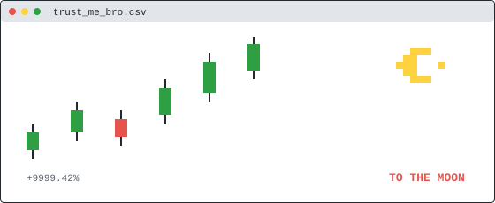
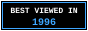

<picture>
  <source media="(prefers-color-scheme: dark)" srcset="assets/dark/banner.svg">
  
</picture>

### `> whoami`

builder of bots · wrangler of LLMs · degen by night

---

### 🕹️ NOW BUILDING

| 🎮 CARTRIDGE | INFO |
| --- | --- |
| 📡 [tg_sentinel](https://github.com/gordonjun2/tg_sentinel) | Telegram sentinel bot (Python) |
| 📈 [crypto-trading-analysis](https://github.com/gordonjun2/crypto-trading-analysis) | market analysis in Jupyter |
| 🧪 [tracectrl](https://github.com/gordonjun2/tracectrl) | web experiment (HTML) |
| 🌐 [agentic-builders-collective.github.io](https://github.com/gordonjun2/agentic-builders-collective.github.io) | builders collective site (Astro) |
| 🔒 serendip-tg `[STEALTH]` | AI matchmaking Telegram mini-app — ask me about it |
| 🔒 aied `[STEALTH]` | adaptive AI learning platform |
| 🔒 shorts-gen-wealth `[STEALTH]` | short-form finance content pipeline |

### 🧰 LOADOUT

<table>
  <tr>
    <td width="50%">
      <picture>
        <source media="(prefers-color-scheme: dark)" srcset="https://github-readme-stats.vercel.app/api?username=gordonjun2&show_icons=true&hide_border=true&count_private=true&theme=github_dark">
        
      </picture>
    </td>
    <td width="50%">
      <picture>
        <source media="(prefers-color-scheme: dark)" srcset="https://github-readme-stats.vercel.app/api/top-langs/?username=gordonjun2&layout=compact&hide_border=true&theme=github_dark">
        
      </picture>
    </td>
  </tr>
</table>

### 📈 CRYPTO CORNER

`$ cat trust_me_bro.csv`

### 🚧 OLD WEB ZONE

### 👾 CONTACT

`> INSERT COIN TO CONNECT:` [▶ PRESS START](mailto:gordonoh@yahoo.com.sg)

