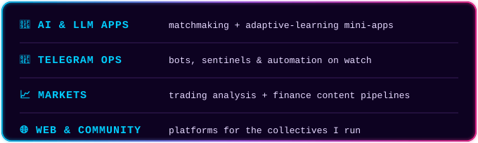

<picture>
  <source media="(prefers-color-scheme: dark)" srcset="assets/dark/hero-night.svg">
  
</picture>

### `> whoami`

builder of bots · wrangler of LLMs · degen by night

<picture>
  <source media="(prefers-color-scheme: dark)" srcset="assets/dark/divider.svg">
  
</picture>

`> full inventory:` [REPOSITORIES](https://github.com/gordonjun2?tab=repositories)

managing a community with my team →

<table>
  <tr>
    <td width="50%">
      <picture>
        <source media="(prefers-color-scheme: dark)" srcset="https://github-readme-stats.vercel.app/api?username=gordonjun2&show_icons=true&hide_border=true&count_private=true&theme=synthwave">
        
      </picture>
    </td>
    <td width="50%">
      <picture>
        <source media="(prefers-color-scheme: dark)" srcset="https://github-readme-stats.vercel.app/api/top-langs/?username=gordonjun2&layout=compact&hide_border=true&theme=synthwave">
        
      </picture>
    </td>
  </tr>
</table>

<picture>
  <source media="(prefers-color-scheme: dark)" srcset="assets/dark/divider.svg">
  
</picture>

`> INSERT COIN TO CONNECT:`

 

